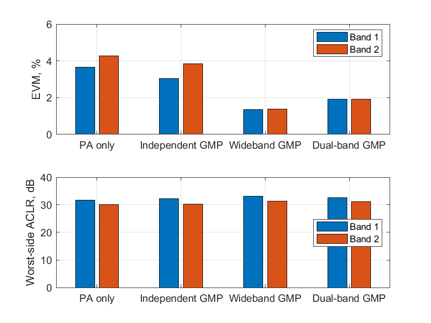
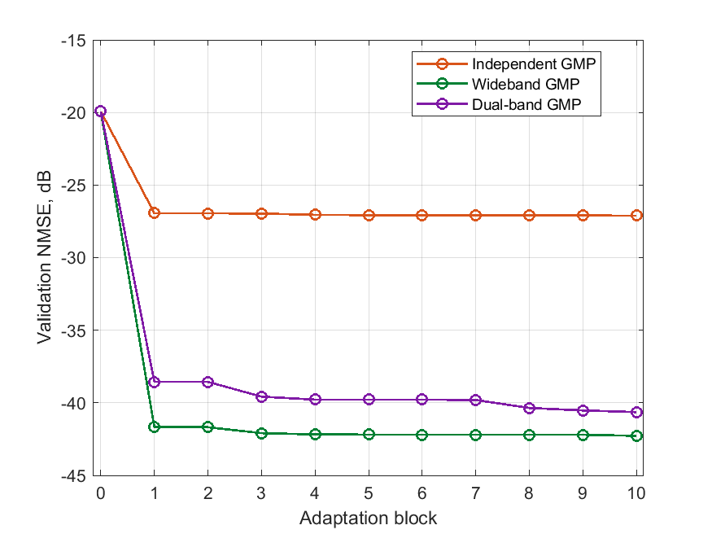

# Dual-band DPD research

Исследование цифрового предыскажения двухполосного OFDM-сигнала в MATLAB. Две частотные полосы проходят через общий нелинейный усилитель мощности. Цель работы состоит в уменьшении ошибок модуляции и утечки мощности в соседние каналы.

Сравниваются три структуры DPD. Independent GMP обрабатывает каждую полосу отдельно. Wideband GMP работает с суммарным сигналом. Dual-band GMP учитывает взаимное влияние полос через обе огибающие.

Используется обученная GMP-модель усилителя. Обучение DPD выполняется по ILA на десяти последовательных блоках с регуляризацией Тихонова. Выбор обновлений и итоговая оценка выполняются на отдельных кадрах. Реализован подбор порядка полинома и глубины памяти и числа диагоналей.

В текущем эксперименте EVM двух полос без DPD составляет 3.66% и 4.27%. Для Wideband GMP получено 1.35% и 1.37%. Для Dual-band GMP получено 1.91% и 1.90%. В этом сценарии лучший результат показывает Wideband GMP.

[Спектры сигналов](docs/results/spectrum.png)

[ACLR по сторонам каждой полосы](docs/results/aclr.png)

[Численные результаты](docs/results/comparison.csv)

Работа продолжается. Исследуется влияние расстояния между полосами и соотношения их мощностей. Продолжается подбор параметров DPD и сравнение качества со сложностью моделей.
